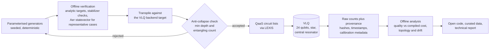

# VLQ-CONNECT

**Topology-aware benchmarking of resonator-mediated connectivity on VLQ, the 24-qubit star-topology quantum computer of EuroHPC.**

> **Status: access approved.** Proposal `EHPC-QCP-2026Q02-037` was evaluated positively in the EuroHPC Quantum Access Pilot Call and awarded **3 QPU hours on VLQ (24Qubit Star) for a period of 6 months** (final results notified on 25 September 2026). Implementation starts with onboarding on the allocated backend. No VLQ measurement has been taken yet and none is claimed here.

## Why this matters if you plan to run something on a quantum computer

Vendor datasheets quote gate fidelities and qubit counts. They do not tell you what happens to *your* circuit once it is compiled for a specific machine. On superconducting hardware the gap between the two is often decided by connectivity: if two qubits that must interact are not physically coupled, the compiler inserts extra operations, the circuit gets deeper, and noise accumulates.

VLQ takes an unusual route. Its 24 superconducting data qubits are arranged in a star around a central resonator, which gives one-to-all connectivity and is intended to minimise SWAP overhead. EuroHPC names the Quantum Fourier Transform as an application suited to this layout.

VLQ-CONNECT asks the question a hardware buyer or algorithm owner should ask before committing to a platform:

**How do the logical interaction structure of a circuit and the backend compilation affect measured execution quality on the physical device?**

The answer will be reported as measured curves, not assumed as an architectural advantage. Positive and negative outcomes are both useful and both will be published.

## What will be measured

Three established, classically verifiable benchmark families. Every circuit has a known ideal output, so success is scored directly against ground truth.

| Family | What runs | What it tells you | Distinct units |
| --- | --- | --- | --- |
| Prepared-state inverse QFT | Fourier-basis product states built from single-qubit gates, decoded by exact or approximate inverse QFT | Decoding probability of a dense, all-to-all workload as width grows | 198 |
| QFT increment | QFT, add one in the Fourier basis, inverse QFT | Success probability of a full round trip that the compiler cannot cancel away | 66 |
| GHZ and graph states | Sequential, tree-structured and backend-transpiled preparations, with population, parity and stabilizer witnesses | Whether entanglement survives, not just the bit populations | 576 |
| Randomized mirror circuits | Pauli-dressed mirror circuits over six logical topologies (line, ring, star, tree, sparse-random, denser non-local) | Effect of interaction graph at matched width, depth and two-qubit density | 1,500 |
| Stability probes | 32 fixed circuits repeated in 30 sessions | Temporal drift, separated from circuit-dependent effects | 32 |

That is about 2,372 distinct execution units and about 5,640 circuit executions (two time-separated passes of the main matrix plus 960 probe executions), on 2 to 24 data qubits, with 4,000 shots per main execution and 2,000 per probe.

### The quantities behind the table

The Fourier family prepares, for a known integer $x$ on $n$ qubits, the product state

$$
\lvert \tilde{x} \rangle = \bigotimes_{k=1}^{n} \frac{1}{\sqrt{2}} \left( \lvert 0 \rangle + e^{2 \pi i x / 2^{k}} \lvert 1 \rangle \right)
$$

and decodes it with an inverse QFT, so the ideal outcome is the bit string of $x$. The increment benchmark has the ideal outcome $x + 1 \bmod 2^{n}$. At full width, the exact QFT source circuit contains

$$
\frac{n(n-1)}{2} = 276 \quad \text{controlled rotations for } n = 24
$$

before native decomposition, which is precisely the kind of non-local workload that punishes sparse coupling maps.

Mirror circuits are scored by the effective polarization, which rescales the observed success probability $P$ of a width-$w$ circuit so that a fully depolarized output maps to zero:

$$
S = \frac{4^{w}}{4^{w} - 1} P - \frac{1}{4^{w} - 1}
$$

For every circuit the project keeps the source and transpiled representations, native depth and native entangling-operation count, so that execution quality can be related to compilation cost rather than reported in isolation.

## How it works

Design choices that make the results trustworthy:

- **Non-adaptive campaign.** Circuit definitions, measurement settings, shot counts and depths are frozen before the principal QPU run. No result-dependent loop, no mid-circuit measurement, no pulse-level control.
- **Compiler cannot cheat.** Barriers, controlled transpilation and a post-transpilation minimum depth and entangling-count check keep optimisation from collapsing a benchmark into a trivial circuit.
- **Drift is controlled, not ignored.** Execution order is randomised, the main matrix runs in two time-separated passes, and a fixed probe set is interleaved across the allocation.
- **Raw data stays primary.** Any readout-mitigated analysis is reported separately with its method and uncertainty.
- **Full provenance.** Each result carries source and transpiled circuit hashes, seeds, software versions, job timestamps, backend status and available calibration metadata.
- **Portable core.** Benchmark definitions and analysis are backend-independent; VLQ access lives in a small adapter, so another device can be added through an adapter and a topology description.

## Resource budget

The request was sized from the hosting entity's published accounting model rather than a guess:

$$
t_{\text{billed}} = N_{\text{jobs}} \cdot \max \left( N_{\text{shots}} \cdot t_{\text{shot}},\ 0.9\ \text{s} \right), \qquad t_{\text{shot}} \le 400\ \mu\text{s}
$$

where the worst-case per-shot cost is about 350 microseconds of fixed post-processing plus up to 50 microseconds of circuit execution. Queue and result-retrieval latency is not billed. The baseline matrix together with compatibility and contingency work fits the awarded 3 QPU hours, equal to 10,800 QPU seconds.

| Item | Value |
| --- | --- |
| System | VLQ, 24 superconducting data qubits, central-resonator star topology, hosted by IT4Innovations |
| Allocation | 3 QPU hours over 6 months |
| Access path | LEXIS session layer and the IT4Innovations QaaS client |
| Stack | Python, Qiskit, Qiskit Aer, NumPy, SciPy, `qaas`, `py4lexis` |
| Classical needs | Single workstation, about 5 GB storage, no HPC allocation |
| Licence | Apache License 2.0 |

## Roadmap

| Phase | Work |
| --- | --- |
| Onboarding | Inspect the allocated backend target, native operation set, batching and accounting; pin dependency versions |
| Build | Implement generators, estimators, result schema and the VLQ adapter; verify against analytic and simulated references |
| Compatibility batch | Small run to confirm transpilation behaviour and metadata, then freeze the execution matrix |
| Campaign | Two time-separated passes of the main matrix with interleaved stability probes |
| Release | Code (planned `v0.1.0`), curated dataset, technical report; a preprint if the results support one |

Allocation start and end dates are set by the hosting entity and will be added here once confirmed.

## Related work by the same author

[`qre-virtual-bench`](https://github.com/spital/qre-virtual-bench) is a public prototype for deterministic Qiskit transpilation and topology-aware compilation analysis on synthetic device profiles, with seeded workloads, a golden test set, dependency locking and reproducible artifacts. Under equal declared constants it reports 19.7 per cent fewer two-qubit gates for a synthetic square-grid profile than for a synthetic heavy-hex-style profile. It demonstrates the classical pipeline; it is not a VLQ implementation and contains no hardware result.

## For prospective clients

This project is open, non-proprietary research, and it is also a working sample of what I do for clients:

- **Hardware fit assessment.** Given your circuit or algorithm family, estimate compiled cost across candidate topologies before you buy access time.
- **Benchmark design.** Verifiable, compiler-robust test suites with honest metrics, sized against a real billing model.
- **QPU campaign execution.** Preparation, transpilation, submission and analysis of noisy results on superconducting hardware, with several years of hands-on experience on IBM Quantum using the same Qiskit toolchain that VLQ supports.
- **Reproducible delivery.** Seeds, hashes, pinned environments and a clear line between what was measured and what was assumed.

Principal investigator: Ing. Jiri Spitalsky, ARIADNE TECHNOLOGIES LTD.
Contact: [github.com/spital](https://github.com/spital) or file an issue.

## Acknowledgement

Access to VLQ was awarded through the EuroHPC Joint Undertaking Quantum Access Pilot Call, proposal `EHPC-QCP-2026Q02-037`. VLQ is hosted by IT4Innovations National Supercomputing Center.

Useful public references: [VLQ introduction](https://docs.it4i.cz/en/docs/clusters/vlq/introduction), [VLQ consumption guide](https://docs.it4i.cz/en/docs/clusters/vlq/vlq-consumption-guide), [QaaS client](https://github.com/It4innovations/quantum-as-a-service).
